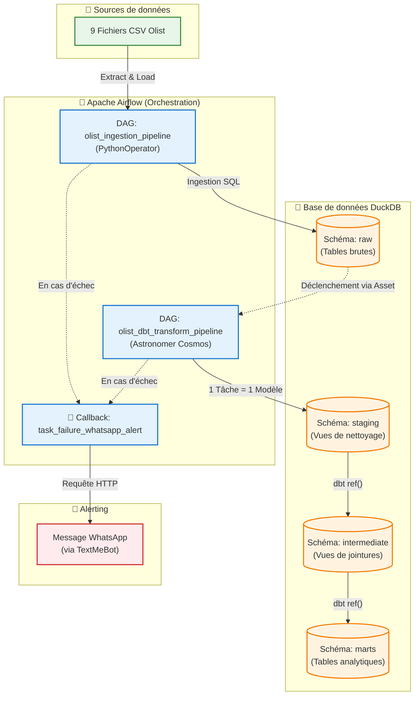

# 🛒 Pipeline de données E-commerce Olist (ELT)

Ce projet est un pipeline de données complet (ELT) construit localement, simulant une architecture moderne de type Modern Data Stack.

## 🏗️ Architecture

1. **Ingestion** : Un DAG Airflow charge 9 fichiers CSV bruts dans un schéma `raw` (DuckDB).
2. **Transformation** : `dbt` transforme les données en modèles analytiques (staging → intermediate → marts).
3. **Orchestration** : Astronomer Cosmos orchestre dbt dans Airflow (1 tâche Airflow = 1 modèle dbt).
4. **Alerting** : Un email est envoyé automatiquement en cas d'échec d'une tâche.

### 📊 Schéma de l'architecture

## 🛠️ Stack Technique
- **Orchestration** : Apache Airflow 3.x
- **Transformation** : dbt Core & dbt-duckdb
- **Intégration dbt** : Astronomer Cosmos
- **Base de données** : DuckDB (fichier local)

## 🚀 Comment exécuter le projet
1. Activer l'environnement virtuel : `source airflow_venv/bin/activate`
2. Démarrer Airflow : `airflow standalone`
3. Lancer l'ingestion : Déclencher le DAG `olist_ingestion_pipeline`
4. Le DAG `olist_dbt_transform_pipeline` se déclenchera automatiquement à la fin de l'ingestion.
